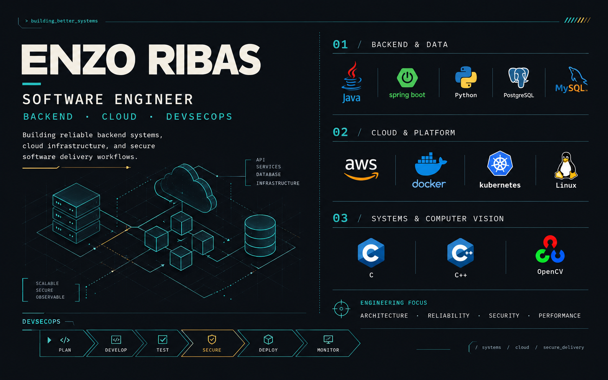

  

  
<strong>Read as text</strong>

  <h2>ENZO RIBAS</h2>
  
<strong>SOFTWARE ENGINEER</strong>

  
<strong>BACKEND · CLOUD · DEVSECOPS</strong>

  
Building reliable backend systems, cloud infrastructure, and secure software delivery workflows.

  <h3>01 / Backend &amp; Data</h3>
  
Java · Spring Boot · Python · PostgreSQL · MySQL

  <h3>02 / Cloud &amp; Platform</h3>
  
AWS · Docker · Kubernetes · Linux

  <h3>03 / Systems &amp; Scientific Computing</h3>
  
C · C++ · Haskell · OpenCV

  <h3>Engineering Focus</h3>
  
Architecture · Reliability · Security · Performance

  <h3>DevSecOps Workflow</h3>
  
Plan → Develop → Test → Secure → Deploy → Monitor

